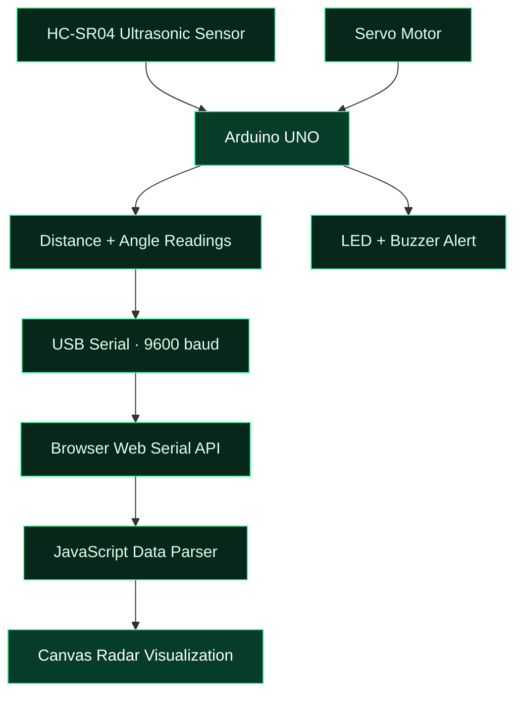

<div align="center">


<br/>


<br/><br/>

**`SENSE`** &nbsp; ⟶ &nbsp; **`PROCESS`** &nbsp; ⟶ &nbsp; **`TRANSMIT`** &nbsp; ⟶ &nbsp; **`VISUALIZE`**

*An embedded sensing project that transforms ultrasonic measurements into a live radar-style visual experience.*

</div>

---

<div align="center">

## `//  SYSTEM BRIEFING`

</div>

**Ultrasonic Radar System** is an Arduino-based object detection and visualization project that combines embedded hardware, ultrasonic sensing, servo-controlled scanning, and browser-based graphics.

An HC-SR04 sensor measures the distance to nearby objects while a servo motor sweeps across a 180-degree range. Arduino transmits angle-distance readings to a web dashboard, where JavaScript renders a radar display and plots valid detections.

The system also uses an LED and buzzer to indicate objects within a configurable proximity threshold.

> `MISSION OBJECTIVE:` Bridge the physical environment and a real-time digital visualization interface.

---

## `01` / RADAR DISPLAY

<div align="center">


<br/><br/>

**Live dashboard preview**

Open [`radar.html`](radar.html) to view the radar interface.

</div>

The dashboard is designed to display:

- Current scanning angle
- Latest measured distance
- Radar sweep line
- Object markers within the configured display range
- Connection and detection status

> **Visual behavior:** The dashboard displays incoming serial readings. Its object markers represent recorded measurements, not guaranteed persistent or independently tracked objects.

---

## `02` / SYSTEM ARCHITECTURE



<div align="center">

`SENSING LAYER` → `CONTROL LAYER` → `COMMUNICATION LAYER` → `VISUALIZATION LAYER`

</div>

---

## `03` / HARDWARE SPECIFICATIONS

| MODULE | FUNCTION | INTERFACE |
|:---|:---|:---|
| Arduino UNO | Main controller | USB serial |
| HC-SR04 | Ultrasonic distance measurement | Trigger / Echo |
| Servo motor | Sensor angular positioning | PWM control |
| LED | Visual proximity indication | Digital output |
| Buzzer | Audible proximity indication | Digital output |
| Breadboard + jumper wires | Circuit assembly | Electrical connections |

### Pin assignment matrix

| SIGNAL | ARDUINO UNO PIN |
|:---|:---:|
| Ultrasonic TRIG | `D9` |
| Ultrasonic ECHO | `D10` |
| Servo signal | `D6` |
| LED | `D4` |
| Buzzer | `D5` |

<details>
<summary><b>⚠ ELECTRICAL & INTEGRATION NOTES</b></summary>

- Connect the sensor ground and Arduino ground correctly.
- Use a current-limiting resistor with the LED.
- Check the servo's voltage and current requirements; use a suitable external supply if necessary.
- Keep the external servo supply ground connected to Arduino ground.
- Verify the wiring before powering the circuit.
- The exact hardware performance depends on the sensor, supply, mechanical assembly and environment.

</details>

---

## `04` / DATA PROCESSING PIPELINE

<table>
<tr>
<td width="65">

**`STAGE 01` — ACQUISITION**

The ultrasonic sensor emits a pulse and receives its echo.

</td>
<td align="center" width="35">

`HC-SR04`

</td>
</tr>
<tr>
<td>

**`STAGE 02` — DISTANCE ESTIMATION**

Arduino calculates distance from the measured echo duration.

</td>
<td align="center">

`TIME → DISTANCE`

</td>
</tr>
<tr>
<td>

**`STAGE 03` — ANGULAR ASSOCIATION**

Each measurement is associated with the current servo angle.

</td>
<td align="center">

`ANGLE + CM`

</td>
</tr>
<tr>
<td>

**`STAGE 04` — SERIAL TRANSMISSION**

Readings are sent to the browser as comma-separated values.

</td>
<td align="center">

`USB / 9600 BAUD`

</td>
</tr>
<tr>
<td>

**`STAGE 05` — VISUAL RENDERING**

JavaScript parses valid readings and plots them on the radar canvas.

</td>
<td align="center">

`CANVAS API`

</td>
</tr>
</table>

### Serial data format

```text
angle,distance
0,42
2,40
4,38
6,0
```

These are illustrative examples, not recorded experimental results. In the current firmware, a distance of `0` indicates that no valid echo was received before the timeout.

---

## `05` / SOFTWARE STACK

<div align="center">


</div>

| SOFTWARE COMPONENT | RESPONSIBILITY |
|:---|:---|
| Arduino IDE | Compile and upload firmware |
| Servo library | Control servo positioning |
| HTML | Dashboard structure |
| CSS | Dark radar-themed styling |
| JavaScript Canvas | Radar drawing and object plotting |
| Web Serial API | Browser access to USB serial data |

---

## `06` / DEPLOYMENT SEQUENCE

<details>
<summary><b>01 — PREPARE THE CONTROLLER</b></summary>

1. Install Arduino IDE.
2. Open `Arduino-Ultrasonic-Radar.ino`.
3. Install the Servo library if needed.
4. Select Arduino UNO and the correct serial port.
5. Upload the firmware.

</details>

<details>
<summary><b>02 — INITIALIZE THE DASHBOARD</b></summary>

1. Open the repository in your local development environment.
2. Start a local web server, such as VS Code Live Server.
3. Open `radar.html` in a compatible desktop browser.
4. Ensure the page runs in a secure context, such as `localhost`.

</details>

<details>
<summary><b>03 — ESTABLISH SERIAL COMMUNICATION</b></summary>

1. Close Arduino Serial Monitor and any other program using the same port.
2. Click **Connect Arduino** on the dashboard.
3. Select the correct serial port and grant permission.
4. Confirm that the angle and distance readings update.

</details>

<details>
<summary><b>04 — TROUBLESHOOTING</b></summary>

| ISSUE | CHECK |
|:---|:---|
| Port unavailable | Close Serial Monitor and other serial applications |
| Browser API unavailable | Use a supported desktop browser and secure context |
| No distance reading | Check sensor wiring and target distance |
| Servo does not move | Check signal pin, power supply and ground |
| Dashboard remains blank | Confirm the serial format and baud rate match the firmware |

</details>

---

## `07` / REPOSITORY STRUCTURE

```text
Arduino-Ultrasonic-Radar/
│
├── Arduino-Ultrasonic-Radar.ino
│   └── Sensor acquisition, servo scan and alerts
│
├── radar.html
│   └── HTML + CSS + JavaScript dashboard
│
└── README.md
    └── Technical documentation
```

---

## `08` / APPLICATION DOMAINS

<div align="center">

| `ROBOTICS` | `EMBEDDED SYSTEMS` |
|:---:|:---:|
| Obstacle-detection experiments | Sensor interfacing |

| `AUTOMATION` | `DATA VISUALIZATION` |
|:---:|:---:|
| Proximity alerts | Live measurement display |

</div>

This project is intended as an educational prototype for learning ultrasonic sensing, servo control, serial communication and real-time browser visualization. It is not a certified safety or navigation system.

---

## `09` / ENGINEERING ROADMAP

- [ ] Add configurable detection thresholds
- [ ] Improve invalid-reading handling
- [ ] Add measurement logging and export
- [ ] Improve object persistence and tracking
- [ ] Add wireless telemetry
- [ ] Develop a mobile-friendly control interface
- [ ] Evaluate measurement repeatability under different conditions

---

<div align="center">

## `SYSTEM END // BUILD IN PROGRESS`


<br/><br/>

**PRATIGYA KAUSHIK**

Electronics & Computer Science Engineering

*Exploring the intersection of embedded systems, IoT and interactive engineering.*

<br/>

`SENSE THE WORLD. VISUALIZE THE SIGNAL.`


</div>
